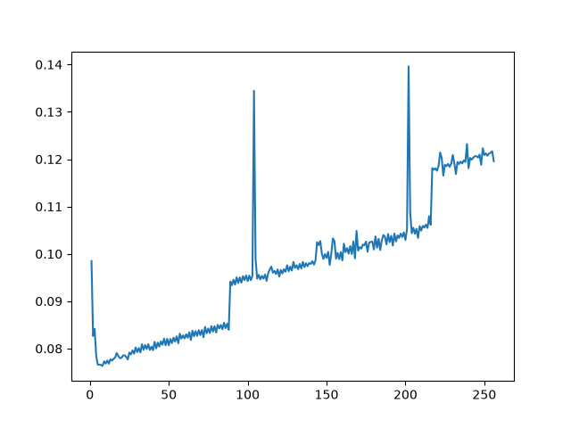

# Results

## 2026-11-10 · Day 34 baseline

Greedy decode with Forge, no KV cache. Each new token runs the full sequence through the model. `torch.cuda.synchronize()` runs before the clock is read, so each sample is the time the GPU spent on that step. The loop does not stop on end-of-sequence.

- GPU: NVIDIA GeForce RTX 4060 (8 GB)
- Model: meta-llama/Llama-3.2-1B-Instruct
- dtype: bfloat16
- Prompt: "How are you today?"
- New tokens: 256
- Decode time: 24.786 s
- Tokens per second: 10.328

The samples are steps 1 through 256. Step time rises across the run, from about 0.08 s near the start to about 0.12 s at the end, with a few spikes above the curve.

